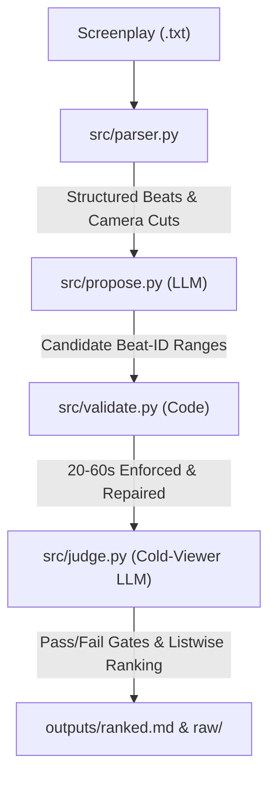

# 🎬 Kuku Microdrama Promo Discovery Tool

Automated promotional cutpoint extractor for serialized vertical microdramas (*I Married a Broken Soldier. He was a Duke*, 50 Episodes).
Discovers high-converting **20 to 60-second** promo ad clips from screenplay files for mobile ad platforms (TikTok, Instagram Reels, YouTube Shorts).

---

## 🔗 Quick Links & Key Deliverables

| Deliverable / Surface | Description | Link |
| :--- | :--- | :--- |
| **🚀 Live Deployed Website (Vercel)** | Production Next.js web application deployed live on Vercel | **[https://kuku-ai-generalist.vercel.app/](https://kuku-ai-generalist.vercel.app/)** |
| **🌐 Local Next.js Dashboard** | Primary UI with Top 15 Promos, 50-Episode Browser, Real-Time Search & Batch Runner | **[http://localhost:3000](http://localhost:3000)** (`frontend/`) |
| **🎈 Local Streamlit App** | Alternative Python web dashboard | **[http://localhost:8501](http://localhost:8501)** (`app.py`) |
| **🏆 Top 15 Ranked Promos** | Final listwise-ranked promotional cuts with exact boundaries and conversion rationales | [`outputs/ranked.md`](outputs/ranked.md) |
| **⚠️ Failure Modes & Audits** | 6 documented real failure modes, mitigations, and run1 vs run2 evidence | [`eval/failures.md`](eval/failures.md) |
| **📖 Architecture & Invariants** | System design, cold-viewer rules, duration repair invariants, and operational runbook | [`AGENTS.md`](AGENTS.md) |
| **📝 Technical Notes & Logs** | Assumptions, quota observations, and prompt engineering logs | [`NOTES.md`](NOTES.md) |
| **📊 Benchmark Evaluation** | Ground truth label validator, IoU stability evaluator, and baseline comparison | [`eval/evaluate.py`](eval/evaluate.py) |
| **🔍 Timeline CLI Tool** | Deterministic compact episode timeline visualizer (speakers, beats, shot boundaries) | [`tools/show_episode.py`](tools/show_episode.py) |

---

## ⚡ Quick Start (One-Step Run)

### 1. Setup Environment
```bash
python3 -m venv .venv
source .venv/bin/activate
pip install -r requirements.txt
```

### 2. Run CLI with Real Provider (Gemini / OpenAI / Anthropic)
Export your API key and run the batch discovery pipeline over all 50 episodes:

```bash
# Recommended default: Google Gemini (Free Tier, <= 10 calls for all 50 episodes)
export GEMINI_API_KEY="your-gemini-key"
python run.py --provider gemini --model gemini-3.5-flash-lite

# Or OpenAI:
export OPENAI_API_KEY="your-openai-key"
python run.py --provider openai --model gpt-4o-mini

# Or Anthropic:
export ANTHROPIC_API_KEY="your-anthropic-key"
python run.py --provider anthropic --model claude-3-5-haiku-latest
```

*(Offline fallback testing only without API keys: `python run.py --provider mock`)*

### 3. Launch Web App

> **🚀 Live Web Deployment**: The Next.js dashboard is deployed and publicly accessible at **[https://kuku-ai-generalist.vercel.app/](https://kuku-ai-generalist.vercel.app/)** with zero local setup required.

#### Option A: Next.js Production Dashboard (Local, Port 3000)
```bash
cd frontend
npm install
npm run build
npx next start -p 3000
# Open http://localhost:3000
```

#### Option B: Streamlit Web App (Port 8501)
```bash
streamlit run app.py
# Open http://localhost:8501
```
- Upload one or multiple screenplay files (`.txt`), or run preloaded catalog.
- Select your AI provider (`gemini`, `mock`, `openai`, `anthropic`).
- Search by episode (e.g. `3`, `45`), dialogue quotes, or listwise rank (`#1`).

---

## 🏛️ System Architecture



1. **Parser (`src/parser.py`)**: Converts raw screenplays into structured JSON with dialogue, actions, sound effects, and shot boundaries. Tolerant to format drift across episodes.
2. **LLM Abstraction (`src/llm.py`)**: Unified interface supporting Gemini (free tier), Anthropic, OpenAI, and Mock mode. Automatically tracks prompt tokens, completion tokens, call counts, and estimated cost.
3. **Propose (`src/propose.py`)**: Sends full episodes as indexed beats to the LLM. The LLM returns candidate ranges using **beat IDs only** (never hallucinating timestamp arithmetic).
4. **Validate & Repair (`src/validate.py`)**: Deterministically enforces 20.0s - 60.0s clip durations, aligns hooks within 3 seconds, guarantees cuts occur on clean beat boundaries, and dedupes overlapping clips.
5. **Cold-Viewer Judge (`src/judge.py`)**: Simulates a scrolling mobile viewer who only sees the clip transcript plus a 15s peek after the cut. Evaluates 3 hard gates: Hook, Cliffhanger, Standalone Coherence, and produces listwise rankings.
6. **Heuristic Baseline (`src/baseline.py`)**: Keyword & regex scoring engine used for rigorous benchmark comparison.

---

## 🧪 Testing & Evaluation

### Run Unit Tests
Verifies 50/50 parsed episodes, monotonic timestamp ordering, and zero dropped lines:
```bash
pytest tests/
```

### Run Benchmark Evaluation
Evaluates Top-3 Hit Rate, stability, and model agreement against hand-curated gold standard promos (`eval/ground_truth_user.json`):
```bash
python eval/evaluate.py
```

> **Evaluation Gate & Audit Note**: In accordance with project auditing standards, previous synthetic evaluation metrics drafted with AI assistance were moved to `eval/ground_truth_ai_drafted.json` and segregated. Final quantitative evaluation benchmarks are gated upon the supply of human ground-truth clips in `eval/ground_truth_user.json`.

---

## 📁 Output Artifacts
- `outputs/raw/`: Full unedited candidate and judge outputs for all 50 episodes (`episode_001.json` ... `episode_050.json`, plus `all_episodes_summary.md`).
- `outputs/ranked.md`: Top 15 global promotional clips across the entire series with conversion rationales, exact cutpoints, and spoiler notes.
- `eval/failures.md`: In-depth analysis of 6 real failure modes and mitigations.
- `NOTES.md`: Running log of technical assumptions and model edge cases.

---

## 🔒 Confidentiality
Screenplay files (`assets/`) are strictly git-ignored and not committed. The web app accepts scripts via dynamic user upload.
# kuku-ai-generalist
